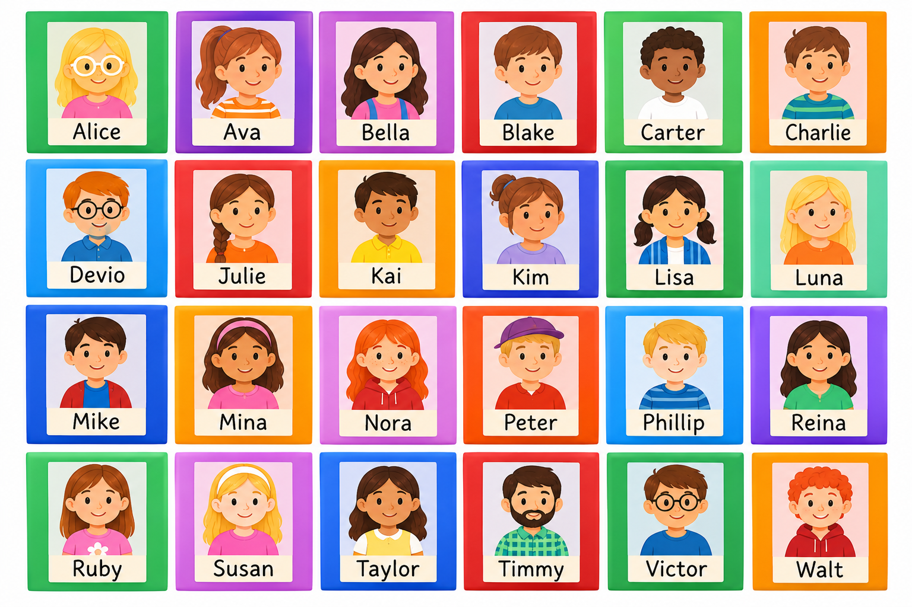

# Binary chop

## A guessing game

> [!TIP]
> In your pairs, one person choose a number between `1` and `9`. 
> The other person is going to guess the number in as few guesses as they can. 
> Every time they guess, tell them if your number is higher or lower than their guess.

### Guaranteeing a win

How many guesses does it take to guarantee getting their number?

> [!TIP]
> Let's play the same game, but this time choose a number between `1` and `99`. 
> How many guesses do you think we'll need with `10` times more numbers to choose from?

Let's try playing against the computer...

### Can we predict how many guesses we'll need?

How many guesses does it take if we're choosing between `1`, `2` and `3`?

What would your strategy be for choosing between `1` and `7`?

  
how many guesses for each number

| guess count | how many numbers | 2 ^ (guess count) |
| --- | --- | --- |
| 1 | 1 | 2 |
| 2 | 3 | 4 |
| 3 | 7 | 8 |
| 4 | 15 | 16 |
| 5 | 31 | 32 |
| 6 | 63 | 64 |
| 7 | 127 | 128 |
| 8 | 255 | 256 |
| 9 | 511 | 512 |
| 10 | 1,023 | 1,024 |
| 11 | 2,047 | 2,048 |
| 12 | 4,095 | 4,096 |
| 13 | 8,191 | 8,192 |
| 14 | 16,383 | 16,384 |

## A weighing problem

Suppose you have a set of scales, and 12 coins. You know one of the coins is fake, and that the fake coin weighs `101` grams compared to the real coins weighing `100` grams.

So e.g. if you put `3` coins on the scale, and you don't have the fake one, it will weigh `300g`. If you do have the fake one, it will weigh `301g`.

What's the least number of weighings you can use to find out which coin is fake?

## Another weighing problem

Suppose you have a set of balance scales, and 12 coins. You know that one of the coins is fake, and that the weight of the fake coin is different, but you don't know if the fake coin is heavier or lighter than the real coins.

What's the least number of weighings you can use to find out which coin is fake?

## Guess who

